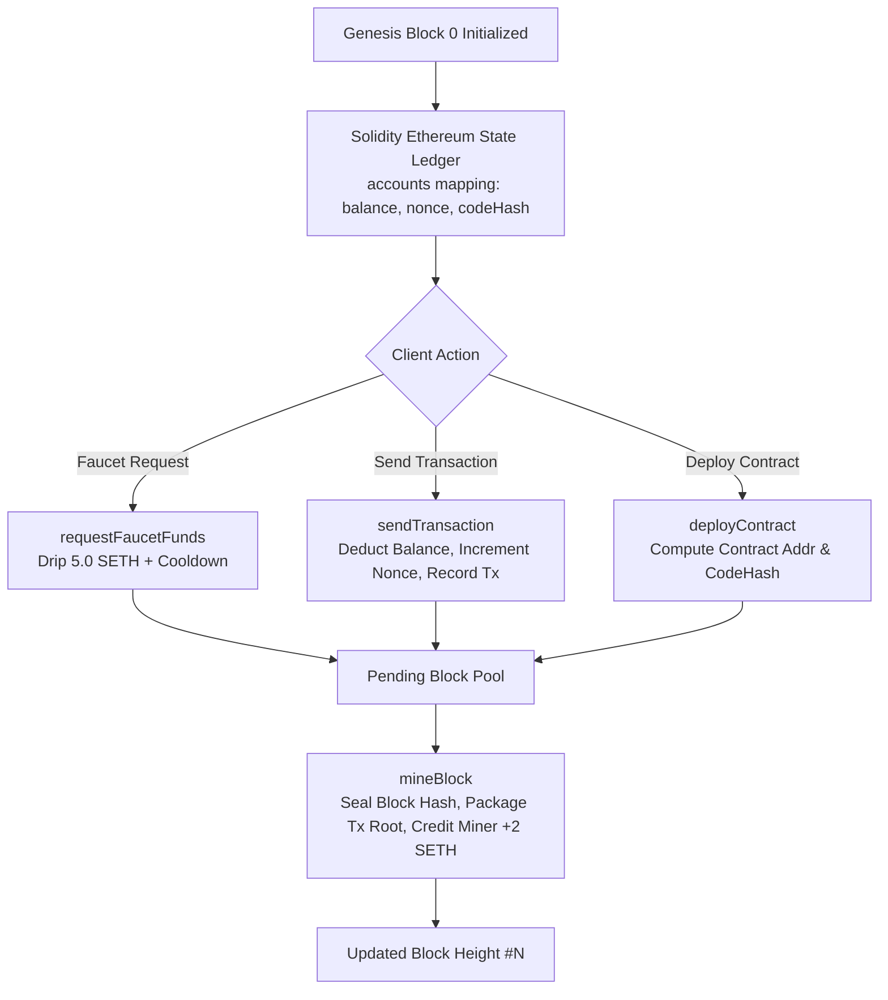

<div align="center">

# ⚡ Solidity Ethereum Testnet (SETH)
### 100% Solidity-Native Ethereum Testnet Engine, State Ledger, Virtual Block Simulator & On-Chain Consensus Sandbox

[](LICENSE)
[](https://soliditylang.org/)
[](https://hardhat.org/)
[](https://docs.ethers.org/)
[](https://expressjs.com/)
[](https://vercel.com/new/clone?repository-url=https%3A%2F%2Fgithub.com%2Fbasantzp%2Fsolidity-ethereum-testnet)

<p align="center">
  <b>A complete, self-contained Ethereum virtual network where the blockchain ledger, account balances, transaction pipeline, Genesis state, virtual contract deployments, miner block rewards, and Proof-of-Authority (PoA) consensus are implemented entirely in Solidity smart contracts.</b>
</p>

</div>

---

## 📖 Overview

Most Ethereum testnets rely on external Go/Rust/C++ clients (Geth, Besu, Nethermind, Erigon) to manage state transitions. 

**`Solidity Ethereum Testnet (SETH)`** takes an innovative, pure smart contract approach: the **entire blockchain state machine, block validation, gas accounting, transaction pool, and block engine are encoded in Solidity contracts**.

### 🌟 Key Features
- **🪙 Native Currency (SETH)**: Complete on-chain account ledger tracking virtual balances, nonces, and transaction execution.
- **📦 Virtual Block Engine**: Validates block headers, packages transactions, computes Keccak-256 block hashes, and pays out +2.0 SETH block subsidies to validator miners.
- **💧 Built-in Rate-Limited Faucet**: Dispenses 5.0 SETH with automated cooldowns for testing.
- **📜 Virtual Contract Deployer**: Simulates contract creation bytecodes and computes deterministic contract addresses (`CREATE` opcode simulation).
- **🌐 Real-Time Web Block Explorer**: Beautiful dark-mode UI with live block feed, account inspector, faucet dispenser, and interactive transaction builder.
- **💻 Interactive CLI Runner**: Full-featured command-line interface for inspecting blocks, querying accounts, sending transactions, and mining blocks.

---

## 🏗️ Architecture & State Flow



---

## ⚡ Quickstart

### 1. Installation
```bash
# Clone the repository
git clone https://github.com/basantzp/solidity-ethereum-testnet.git
cd solidity-ethereum-testnet

# Install dependencies
npm install
```

### 2. Run Automated Unit Tests
```bash
npx hardhat test
```
*Output:*
```text
  Solidity Ethereum Testnet (SETH)
    ✔ Should initialize Genesis Block 0 with correct ChainID and Admin Balance
    ✔ Should allow requesting funds from the testnet Faucet
    ✔ Should execute virtual value transfers between accounts
    ✔ Should deploy virtual smart contracts on the testnet
    ✔ Should mine blocks, package transactions, and pay miner subsidies

  5 passing (693ms)
```

---

### 3. Launch Testnet & Web Block Explorer in 1 Click
```bash
./start-testnet.sh
```
* **Web Block Explorer & Faucet UI**: `http://localhost:3300`
* **Local RPC Node**: `http://127.0.0.1:8545`
* **Chain ID**: `13371337` (`SETH`)

To gracefully stop the testnet at any time:
```bash
./stop-testnet.sh
```

---

## 💻 Interactive CLI Usage

Interact with the running Solidity testnet directly from your terminal:

```bash
# 1. View Chain Status & Current Block Height
node cli.js status

# 2. Display All Verified Blocks
node cli.js blocks

# 3. List All Registered Accounts & Balances
node cli.js accounts

# 4. Request 5 SETH from the Faucet
node cli.js faucet 0x70997970C51812dc3A010C7d01b50e0d17dc79C8

# 5. Send a Virtual Transaction (Alice to Bob)
node cli.js transfer 1 0x3C44CdDdB6a900fa2b585dd299e03d12FA4293BC 2.5

# 6. Mine the Next Block (Pay Miner Subsidy)
node cli.js mine
```

---

## 📄 Smart Contracts Overview

| Contract | Source File | Purpose |
| :--- | :--- | :--- |
| **`EthereumTestnet`** | [`contracts/EthereumTestnet.sol`](contracts/EthereumTestnet.sol) | Core state ledger, block producer, transaction pipeline, faucet, and validator consensus. |
| **`TestnetToken`** | [`contracts/TestnetToken.sol`](contracts/TestnetToken.sol) | ERC-20 token (`TUSD`) deployed on testnet for testing swaps, staking, and transfers. |
| **`SimpleStorage`** | [`contracts/SimpleStorage.sol`](contracts/SimpleStorage.sol) | Sample contract to demonstrate contract deployments and state mutations on SETH. |

---

## 🌐 REST API Endpoints

The built-in Express server provides JSON APIs on port `3300`:

| Method | Endpoint | Description |
| :--- | :--- | :--- |
| `GET` | `/api/stats` | Network summary, block height, total supply, and contract addresses. |
| `GET` | `/api/blocks` | Array of all mined blocks with timestamps, miner, gas, and tx count. |
| `GET` | `/api/accounts` | All registered EOAs and virtual contracts with live balances. |
| `POST` | `/api/faucet` | Dispenses 5.0 SETH to the requested `recipient`. |
| `POST` | `/api/transfer` | Dispatches a state transition transfer between virtual accounts. |
| `POST` | `/api/mine` | Mines the next block and awards +2.0 SETH to the miner. |

---

## 📜 License

Distributed under the [MIT License](LICENSE). Built with ❤️ by [Basant Pokhrel](https://github.com/basantzp).
